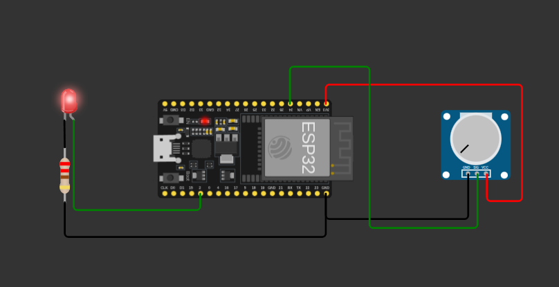

# MSTI Arena Challenge 01 — IoT Telemetry Node

An ESP32-based IoT telemetry node developed for the **ALPHA SCIENCE LAB (ASL) National Arena — Challenge 01**.

<p align="center">
  <a href="https://wokwi.com/projects/479247402232513537">
    
  </a>
  
  
  
</p>

---

## 1. Overview

This project implements an ESP32-based IoT telemetry node that reads analog sensor data, connects to a Wi-Fi network, and transmits sensor readings to an HTTP endpoint.

A potentiometer is used as an analog sensor simulator. The ESP32 reads its output, displays the ADC values through the Serial Monitor, and sends telemetry data approximately every three seconds.

## 2. Features

- ESP32 DevKit V1
- 12-bit ADC resolution (0–4095)
- Real-time analog sensor reading
- Wi-Fi connectivity using `Wokwi-GUEST`
- HTTP GET telemetry transmission
- Approximately 3-second telemetry interval
- GPIO hardware register-based LED control
- Serial Monitor output for sensor readings and HTTP responses
- Wokwi circuit simulation

## 3. System Architecture

```text
       Potentiometer
             |
             v
       ESP32 ADC
        GPIO34
             |
             v
      Sensor Processing
             |
       +-----+------+
       |            |
       v            v
  Serial Monitor  Wi-Fi
                    |
                    v
              HTTP GET Request
                    |
                    v
              HTTP Endpoint
```

The status LED is independently controlled through ESP32 GPIO hardware registers using GPIO2.

## 4. Circuit Diagram



*ESP32 DevKit V1 with potentiometer and status LED.*

**Simulation:** [Open the Wokwi Project](https://wokwi.com/projects/479247402232513537)

## 5. Hardware Configuration

| Component | ESP32 Connection |
|---|---|
| ESP32 DevKit V1 | Main controller |
| Potentiometer SIG | GPIO34 |
| Potentiometer VCC | 3V3 |
| Potentiometer GND | GND |
| Status LED Anode | GPIO2 |
| Status LED Cathode | 220Ω resistor → GND |

## 6. ADC Pin Selection

The current implementation uses **GPIO34** for analog sensor input.

On the classic ESP32:
- GPIO4 and GPIO15 belong to ADC2.
- ADC2 shares hardware resources with Wi-Fi.
- ADC2 readings can conflict with active Wi-Fi operation.
- GPIO34 belongs to ADC1 and supports analog readings while Wi-Fi is active.

Therefore, GPIO34 was selected to maintain reliable sensor readings during Wi-Fi telemetry.

**Specification deviation:** The challenge specifies GPIO4 or GPIO15. This implementation uses GPIO34 instead. The deviation is documented and should be confirmed with the organizers if strict pin compliance is required.

## 7. Telemetry

The ESP32 sends HTTP GET requests to the following test endpoint:

```text
http://httpbin.org/get?sensor=<ADC_VALUE>
```

Example:

```text
http://httpbin.org/get?sensor=2048
```

A successful HTTP response, such as status `200`, indicates that the endpoint received the request successfully.

**Note:** HTTPBin is a testing endpoint. It does not provide permanent telemetry storage. The current implementation uses synchronous HTTP requests, so sensor sampling may temporarily pause during transmission.

## 8. Status LED Control

The status LED connected to GPIO2 is controlled through ESP32 hardware registers.

| Register | Function |
|---|---|
| `GPIO_OUT_W1TS_REG` | Set GPIO output HIGH |
| `GPIO_OUT_W1TC_REG` | Set GPIO output LOW |

The implementation uses direct register writes instead of `digitalWrite()` for LED control.

## 9. Simulation Test Results

The following behaviors have been observed during Wokwi simulation:

| Test | Observed Result |
|---|---|
| ESP32 startup | Successful |
| Wi-Fi connection | Successful |
| ADC readings | Responsive to potentiometer changes |
| ADC range | 0–4095 observed |
| HTTP GET request | Successful |
| HTTP response | Status 200 observed |
| Telemetry interval | Approximately 3 seconds |

These results represent simulation testing, not physical hardware validation.

## 10. Project Structure

```text
ASL-Challenge-01/
├── src/
│   └── main.cpp
├── docs/
│   ├── architecture.md
│   ├── test-results.md
│   └── failure-analysis.md
├── evidence/
│   ├── simulation/
│   └── hardware/
├── presentation/
├── diagram.json
├── platformio.ini
├── wokwi.toml
├── libraries.txt
├── .gitignore
├── LICENSE
└── README.md
```

## 11. Build and Run

### Requirements
- Visual Studio Code
- PlatformIO IDE extension
- ESP32 platform support
- Wokwi simulation extension or Wokwi web project

### Build Firmware

Open the project in VS Code and use the PlatformIO **Build** button.

Alternatively, with PlatformIO CLI installed:

```bash
pio run
```

### Run Simulation

Open the Wokwi project:

[Launch IoT Telemetry Node Simulation](https://wokwi.com/projects/479247402232513537)

Start the simulation and observe sensor readings and HTTP responses in the Serial Monitor.

## 12. Limitations and Future Improvements

- Replace the potentiometer with a real environmental sensor.
- Implement Wi-Fi reconnection and improved failure recovery.
- Integrate a dedicated telemetry server or cloud platform.
- Add sensor data visualization and historical logging.
- Validate the system using physical ESP32 hardware.

## 13. License

This project is released under the [MIT License](LICENSE).

## 14. Challenge Information

**Competition:** ALPHA SCIENCE LAB (ASL) National Arena  
**Challenge:** 01 — Build an IoT Telemetry Node  
**Repository:** [MSTI_Arena-ASL-01](https://github.com/v-aryank/MSTI_Arena-ASL-01)  
**Simulation:** [Wokwi Project](https://wokwi.com/projects/479247402232513537)